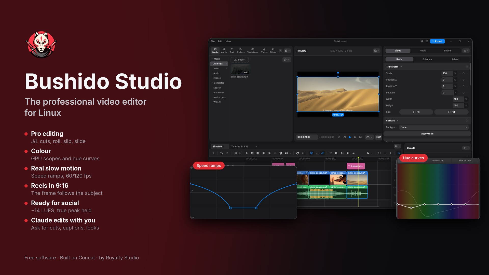
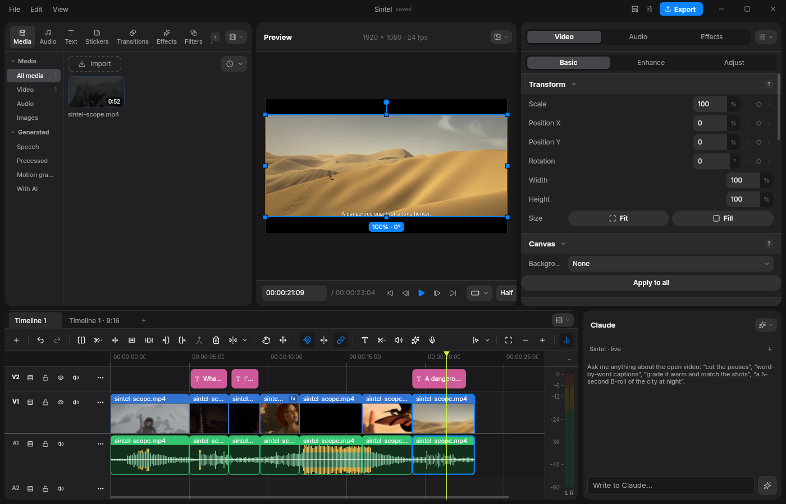
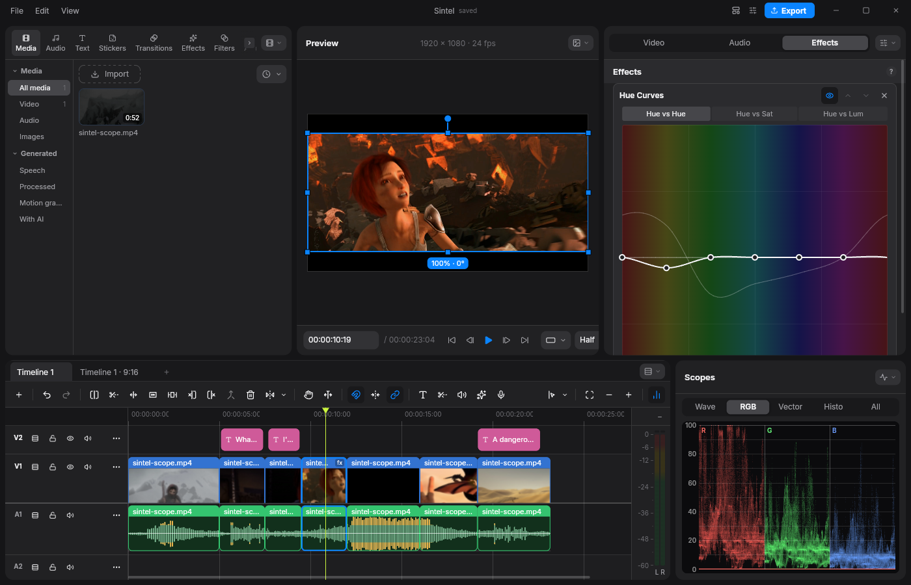
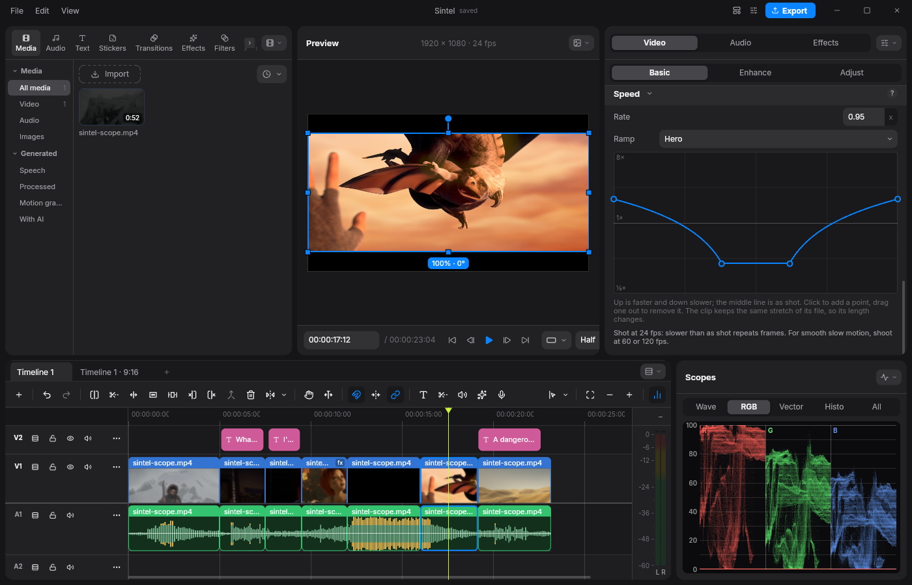
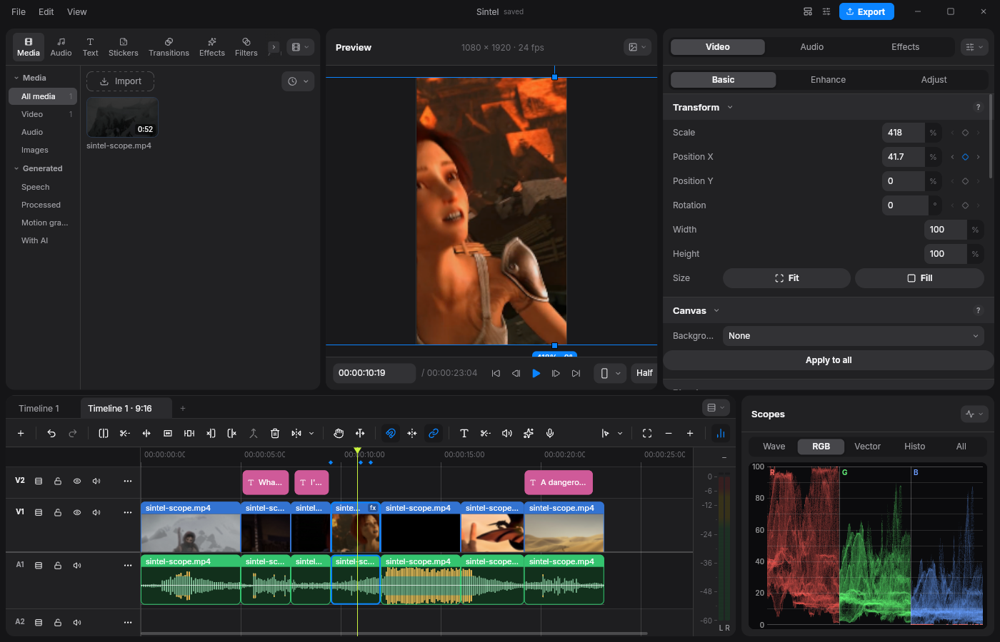
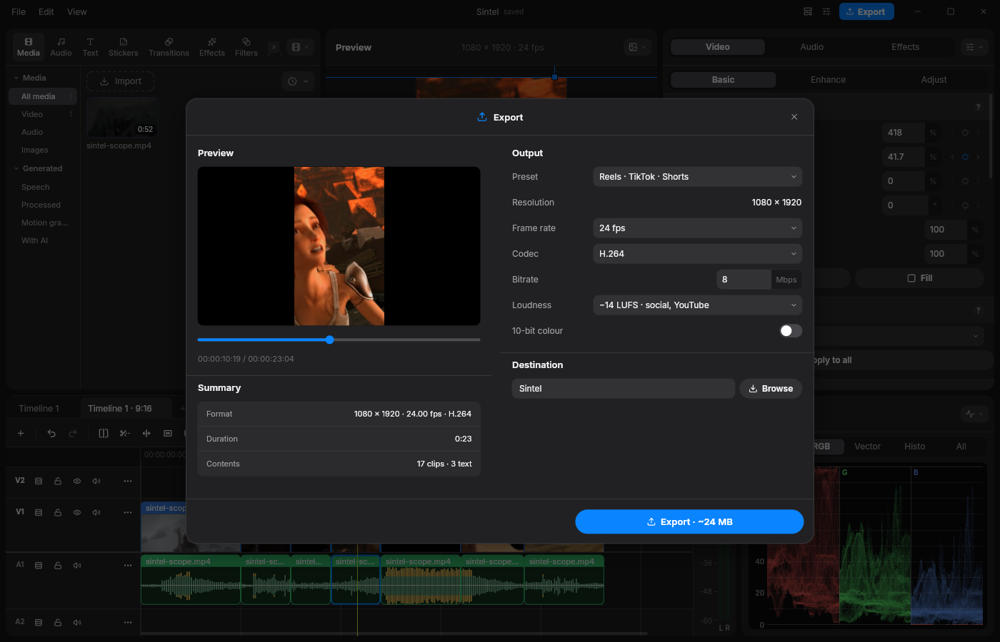

<p align="center">
  
</p>

<h1 align="center">Bushido Studio</h1>

<p align="center">
  <b>The professional video editor for Linux</b><br>
  A more powerful edition of <a href="https://github.com/jub0t/Concat">Concat</a>, built on its code.
</p>

<p align="center">
  <a href="LICENSE"></a>
  
  
  <a href="https://github.com/jub0t/Concat"></a>
</p>



Bushido Studio takes **Concat**, the free video editor by Jareer and the
Concat contributors, and adds what professional work asks for: video and
audio lanes, a real cutting room, colour grading with GPU scopes, speed
ramps and true slow motion, short-form tools for Reels, TikTok and Shorts,
loudness-normalised delivery, and an AI assistant that edits the project
with you. It runs on Linux and puts the graphics card to work for the
preview, the export and the transcription.

> **Built on Concat.** Bushido Studio is a modified version of Concat, made
> by Royalty Studio from Concat 0.2.8. Every line of Concat it carries is
> Concat's work and keeps its authors' copyright; thank you to Jareer and
> everyone who built it. Bushido Studio is not Concat, and the Concat
> project is neither affiliated with it nor responsible for it - please
> report problems with Bushido Studio [here](https://github.com/dcryptoRS/BushidoStudio/issues),
> not to Concat. See [Credits](#credits) and [FORK.md](FORK.md).

## A look inside


*The editor: picture and sound on their own lanes and linked, captions on a lane above, the inspector, and Claude ready to edit.*


*Colour: hue vs hue, saturation and luminance curves round the colour wheel, and GPU scopes measured from the monitor.*


*Speed: ramps from presets or drawn by hand, and a note on what the footage's frame rate allows.*


*Vertical: a 9:16 copy of a horizontal edit in one step, each shot following its subject.*


*Delivery: presets for Reels, TikTok, Shorts, YouTube, podcasts and broadcast, normalised to the platform's loudness.*

## What it adds to Concat

- **Video and audio lanes.** A clip's picture and sound placed on their
  own lanes and linked, unlinked and relinked as in Premiere; Resolve-style
  saving with a recovery copy; a timeline split between picture and sound.
- **The cutting room.** Markers, J-K-L shuttle, in and out points,
  three-point insert and overwrite, lift and extract, roll, slip and slide,
  and J and L cuts in one click.
- **Colour.** GPU scopes - waveform, RGB parade, vectorscope with the
  skin-tone line, histogram - an HSL qualifier for secondaries, hue curves
  (hue vs hue, saturation and luminance), a colour mixer and a
  broadcast-safe limiter.
- **Speed.** Ramps from presets (Montage, Hero, Bullet, Jump, Flash in,
  Flash out) or drawn on a curve, and true slow motion from 60, 120 or
  240 fps footage, every frame its own, in one click.
- **Short-form.** Pauses cut out by the voice, word-by-word captions with
  Whisper, and a vertical version of a horizontal edit, each shot following
  its subject.
- **Sound and delivery.** Music ducked under the voice, delivery presets,
  and exports normalised to a loudness (EBU R128) with the true peak held
  under −1 dBTP.
- **On the GPU.** The preview and the export draw on the graphics card;
  NVIDIA cards decode on NVDEC and encode on NVENC; Whisper transcribes on
  any card through Vulkan.
- **Generated media.** Clips and pictures from Higgsfield (Seedance 2.5),
  BytePlus ModelArk and Gemini, with your own keys kept in the desktop's
  keyring.
- **An assistant that edits.** Claude, in a panel, cuts, captions and
  grades the open project with a professional editor's and colourist's
  craft, measures frames as scopes do, and stays away from the folders you
  protect. Through MCP, any client that speaks it can drive the editor.

Projects, effect ids and MCP tool names are Concat's still, so projects
and scripts move between the two.

## Requirements

- Linux on x86-64; arm64 builds run too, transcribing on the CPU.
- A graphics card with a Vulkan driver - NVIDIA, AMD or Intel - for the
  preview, the export and Whisper; the editor also runs without one.
- For the assistant panel, [Claude Code](https://claude.com/claude-code)
  installed and signed in. For generated media, an account and a key with
  the service.

## Installing

Each [release](https://github.com/dcryptoRS/BushidoStudio/releases) carries
a package for your distribution and an AppImage for any:

| Distribution | File |
| --- | --- |
| Debian, Ubuntu, Mint | `BushidoStudio-<version>-linux-x86_64.deb` |
| Fedora, openSUSE | `BushidoStudio-<version>-linux-x86_64.rpm` |
| Arch | `BushidoStudio-<version>-linux-x86_64.pkg.tar.zst` |
| Any | `BushidoStudio-<version>-x86_64.AppImage` |

The same files exist for `aarch64`. The packages install under
`/opt/bushido-studio` with `bushido-studio` on the path, and the editor
updates itself from this repository's releases. Models (cutout, voices,
Whisper) are downloaded from Concat's mirror the first time they are
needed. A Concat already installed is left alone; the first run copies its
settings and models over.

## Building from source

The Cargo workspace lives in `src/`. As Concat does (see
[docs/CONCAT-README.md](docs/CONCAT-README.md)), it needs Rust (the
version `src/rust-toolchain.toml` pins), CMake, a C++ toolchain, libclang,
the FFmpeg 7+ development libraries and ONNX Runtime;
[.github/workflows/build-app.yml](.github/workflows/build-app.yml) is the
reference build. Then, from `src/`:

```sh
cargo build --profile quick -p concat                    # the editor, binary "bushido-studio"
cargo build --profile quick -p concat --features vulkan  # Whisper on any GPU, as the packages
cargo build --profile quick -p concat --features cuda    # Whisper on CUDA, for an NVIDIA card
```

The Vulkan build needs the Vulkan headers and `glslc`: `libvulkan-dev` and
`glslc` from the distribution where it has them (Debian 13, Ubuntu 24.04
and newer), or [LunarG's Vulkan SDK](https://vulkan.lunarg.com/sdk/home)
where it does not (Ubuntu 22.04). The CUDA build needs the CUDA toolkit.

## Releasing

Pushing a tag `v<version>`, the version being `src/Cargo.toml`'s, runs
[.github/workflows/release.yml](.github/workflows/release.yml): it builds
every package, starts each one in clean distributions, and drafts a
release with the files, their checksums and the manifest the updater
reads.

## Credits

- **[Concat](https://github.com/jub0t/Concat)** by Jareer and the Concat
  contributors - the editor Bushido Studio is built on: its engine,
  timeline, effects, exporter, API and MCP server. Concat's own README is
  kept in [docs/CONCAT-README.md](docs/CONCAT-README.md).
- The open-source projects both stand on, among them Slint, Skia, FFmpeg,
  whisper.cpp, ONNX Runtime and sherpa-onnx: see
  [THIRD_PARTY_NOTICES.md](THIRD_PARTY_NOTICES.md).
- The footage in the screenshots is from the *Sintel* trailer,
  © copyright Blender Foundation | [durian.blender.org](https://durian.blender.org),
  under [CC BY 3.0](https://creativecommons.org/licenses/by/3.0/), cropped
  to 2.35:1.

## Licence

Free software under the GNU Affero General Public License 3.0 or later, as
Concat is: see [LICENSE](LICENSE). Concat's copyright notices are kept in
every file they were in; the files and changes Bushido Studio adds are
© 2026 Royalty Studio under the same licence. What was changed is listed
in [FORK.md](FORK.md). The name Concat and its logo are Concat's
([TRADEMARK.md](TRADEMARK.md)); Bushido Studio uses neither as its own.
